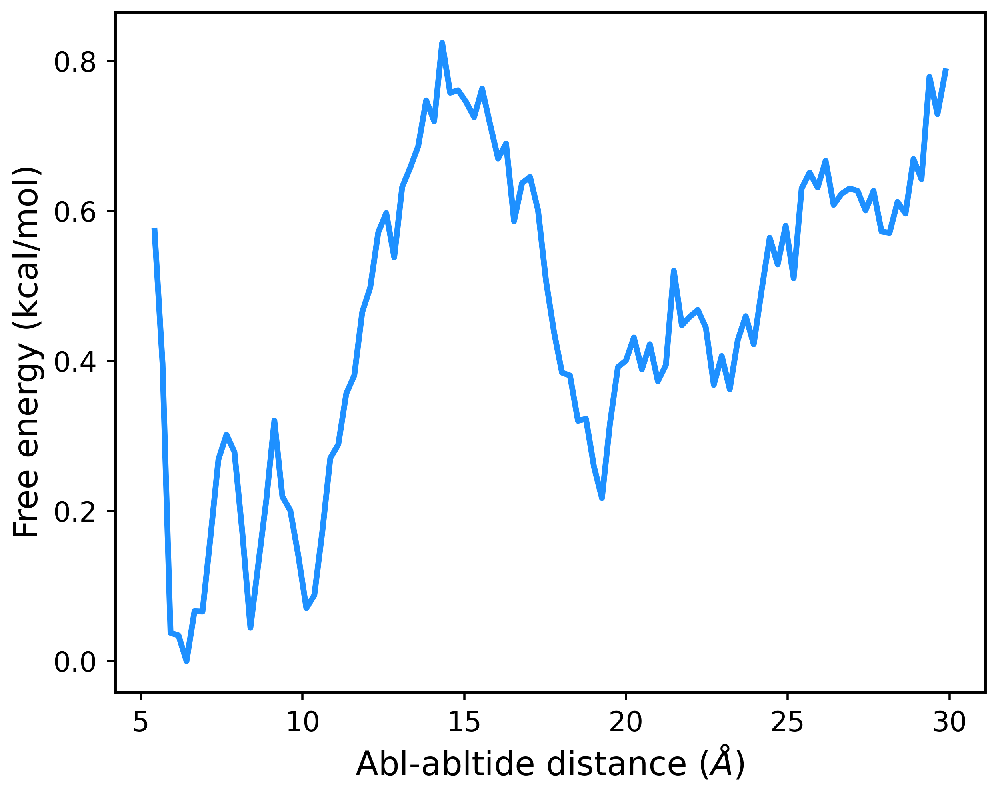

# Example for performing mbar for gREST/REUS simulation

## Introduction

In this tutorial, I will introduce the procedure to perform **mbar** using all the trajectories produced by gREST/REUS simulation. The example will use `mbar_analysis` in **genesis tools** to conduct analysis, you can also use the python package---`pymbar` to conduct the analysis. The principles behind those tools are the same.

In `example` directory, I prepare all the necessary input files. You can use them to fllow the tutorial. In my simulation, I used 8 gREST replicas and 32 REUS replicas, the total replicas are 288. The relation between replica index and gREST index and REUS index are shown below:

```raw
replica index   1   2 ... 35  36  37  38 ... 71  72  73  74 ... 107 108 109 110 ... 287 288   
gREST index     1   1 ... 1   1   2   2  ... 2   2   3   3  ... 3   3   4   5   ... 8   8
REUS index      1   2 ... 35  36  1   2  ... 35  36  1   3  ... 34  35  1   2   ... 35  36
```

In the `example` directory, the `input/energy/{}.ene` files record the energy in different gREST parameter for each replica simulation, the `input/dist/{}.dat` file record the distance used for preforming spring restraint for each replica simulation. The `input/K.dat` records the restraint consts and the `input/center.dat` records the restraint center distance for each REUS parameter.

## Generate the target file

**target file** records potential energy for target system that we desired to get the weights of each frame. In the example, it means the potential energy in lowest gREST temperature and without REUS bias. In this example, the `input/energy/{}.ene` records the potential energy in different gREST parameter for each replicas without REUS constraints, so we can extract the target energy from the second column in `input/energy/{}.ene` file (The first column in index). In this tutorial, you can run `target_energy.tcl` to extract the target energy, it will generate `output/target_energy/{}.ene`.

## Generate the parameter energy file

Then, we will generate the **parameter energy file**, it records the potential energy evaluated under differerent parameter for each replica. In the gREST/REUS simulation, we totally have 288 different parameters, we need to generate **parameter energy file** containing 288 columns of potential energy. You can run `parameter_energy.tcl` to generate those energy date, it will generate `output/parameter_energy/{}.ene`. Because the **parameter energy file** will have 288 columns of potential energy, it may be very large.

## Run `mbar_analysis`

Now, we have prepared all the necessary files. We can use `mbar_analysis` to generate the weights of all frames. The input file of `mbar_analysis` is:

```raw
[INPUT]
cvfile             = output/parameter_energy/{}.ene # parameter energy file
targetfile         = output/target_energy/{}.ene    # target energy file
 
[OUTPUT]
fenefile           = result/fes/output.fene         # free energy file
weightfile         = result/fes/output{}.weight     # weight file
 
[MBAR]
nreplica           = 288
input_type         = EneAll
dimension          = 1
nblocks            = 1
self_iteration     = 10  # if we don't have enought self_interation, the Newton solution will fail
temperature        = 310
target_temperature = 310
```

Here, we set `input_type = EneAll`, it will use total potential energy to perform mbar analysis.

We can use below command to perform analysis:

```bash
$GENESIS_BIN/mbar_analysis mbar.inp
```

After this process, the free energy file `result/fes/output.fene` and weight file `result/fes/output{}.weight` will be generated.

## Run `pmf_analysis`

Now, we can use `pmf_analysis` to get free energy profile. The input for `pmf_analysis` is:

```raw
[INPUT]
cvfile       = input/dist/{}.comdis
weightfile   = result/fes/output{}.weight

[OUTPUT]
pmffile      = result/pmf/dist.pmf

[OPTION]
nreplica     = 288             # number of replicas
dimension    = 1             # dimension of cv space
temperature  = 310.0
grids1       = 5.3 30.0 101      # (min max num_of_bins)
band_width1  = 0.1
is_periodic1 = NO            # periodicity of cv1
```

We can use below command to get the result:

```bash
$GENESIS_BIN/pmf_analysis pmf.inp
```

After analysis, we can use `plot_pmf.py` to show the result. The result will like below:

<center></center>

## Appendix

- The **parameter energy file** may be very large, so be careful about the disk space.
- By using all the trajectories in gREST/REUS simulation, it maybe need a large memory to perform analysis.
- By use this way, we can use any number of replicas to perform the mbar analysis by changing the `nreplica` in `mbar.inp`.
